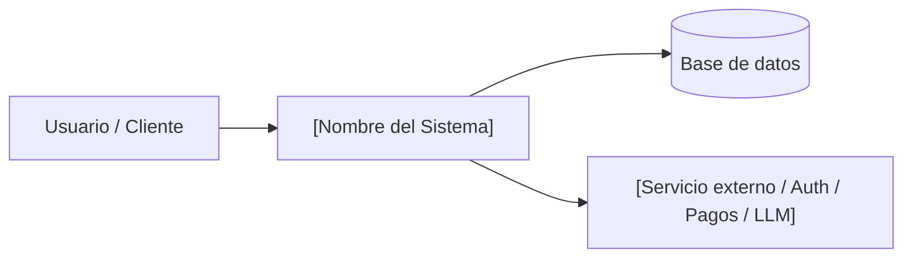

# Arquitectura del Sistema — [Nombre del Proyecto]

> Plantilla base alineada a ISO/IEC/IEEE 42010 y C4. Sustituye los bloques entre corchetes `[...]` con la información real del sistema.

## 1. Propósito y alcance
- **Nivel del proyecto:** `[Nivel 1: MVP | Nivel 2: Producto/SaaS | Nivel 3: Empresarial/Regulado]`
- **Objetivo del sistema:** `[Descripción breve del problema que resuelve]`
- **Atributos de calidad prioritarios (ISO/IEC 25010):** `[Ej. Seguridad, Fiabilidad, Rendimiento, Mantenibilidad]`

## 2. Diagrama de Contexto (C4 — Nivel 1)

## 3. Contenedores y componentes principales (C4 — Nivel 2)
| Componente | Tecnología | Responsabilidad | Comunicación |
| :--- | :--- | :--- | :--- |
| `[Frontend Web / Móvil]` | `[Ej. React / Flutter]` | `[Interfaz de usuario]` | `[HTTPS / REST JSON]` |
| `[API / Backend]` | `[Ej. FastAPI / .NET / Node]` | `[Lógica de negocio y autorización]` | `[SQL / Colas / APIs]` |
| `[Base de datos]` | `[Ej. PostgreSQL]` | `[Persistencia transaccional]` | `[TLS / Pool interno]` |

## 4. Reglas arquitectónicas y límites
- **Estilo arquitectónico:** `[Ej. Capas / Clean Architecture / Modular Monolith]`
- **Dependencias permitidas:** `[Ej. Presentación -> Aplicación -> Dominio; Infraestructura implementa puertos de Dominio]`
- **Manejo de errores de API:** `[Problem Details RFC 9457]`
- **Trazabilidad:** `[Correlation ID en cada solicitud]`

## 5. Decisiones Arquitectónicas (ADRs)
| ID | Decisión | Estado | Enlace |
| :--- | :--- | :--- | :--- |
| `ADR-0001` | `[Elección de arquitectura y stack inicial]` | `[Aceptado]` | `[./docs/adr/ADR-0001.md]` |

## 6. Riesgos técnicos y deuda conocida
- `[Riesgo / supuesto 1 y su mitigación]`
